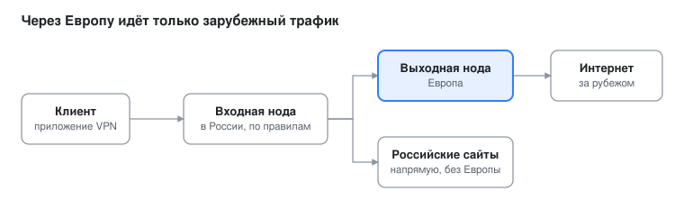
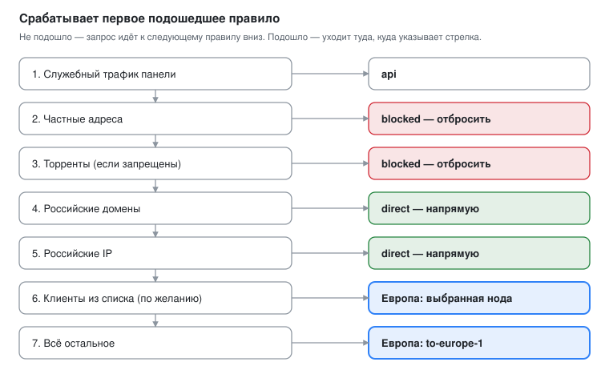

[← к README](../README.md)

# Каскад: вход в России, выход в Европе

Каскад — это когда клиент подключается к ноде в России, а наружу трафик выходит через ноду в Европе.
Дальше вход решает сам, куда направить каждый запрос: российские сайты и адреса уходят напрямую, всё
остальное — через европейскую ноду. Для российских сайтов виден адрес входной ноды, для зарубежных —
выходной.

> Это **необязательная** настройка, она делается руками в панелях двух нод. Скрипт каскад сам не создаёт:
> он ставит обычные ноды, а каскад собирается из них в панели (Xray → исходящие и маршрутизация).

Развилка на входной ноде: российский трафик уходит напрямую, остальное — на выходную ноду и дальше в интернет.

## Что понадобится

- **Две ноды с панелью:** входная (в России, к ней подключаются клиенты) и выходная (в Европе, через неё трафик выходит в интернет).
- **На выходной ноде** рабочий инбаунд VLESS + XHTTP + Reality (его создаёт скрипт, см. [xhttp.md](xhttp.md)).
- **Доступ к панелям обеих нод** и возможность перезапустить Xray из панели.
- **Несколько значений** с выходной ноды, их нужно будет вставить на входную: адрес (домен), порт, UUID клиента,
  параметры Reality (SNI, публичный ключ, shortId) и путь XHTTP. Откуда их взять, описано в шаге 1.

## Шаг 1. Клиент для каскада на выходной ноде

Входная нода подключается к выходной так же, как обычный клиент. Поэтому ей нужен свой клиент, отдельный
от клиентов-людей: так виден его трафик, и при утечке его можно удалить, не трогая остальных.

> **Важно:** не создавайте для каскада новый инбаунд. Инбаунд на другом порту не заработает, пока этот порт
> не открыт в файрволе (ufw и, если есть, у хостера). Используйте существующий XHTTP + Reality на 443: порт на нём
> уже открыт, и менять в файрволе ничего не придётся.

1. В панели **выходной** ноды найдите уже работающий инбаунд VLESS + XHTTP + Reality (его создал установочный скрипт) и откройте его. Новый инбаунд создавать не нужно.
2. Добавьте клиента через вкладку «Клиенты»: укажите понятное имя, например `cascade-ru1`, и привяжите его к инбаунду VLESS + XHTTP + Reality. UUID панель создаст сама.
3. Не ставьте ему лимит трафика. Лимит по IP не нужен: входная нода подключается с одного адреса.
4. Выпишите значения для следующего шага:

| Что | Где взять в панели выходной ноды |
| --- | --- |
| Адрес и порт | домен ноды и порт инбаунда (обычно 443) |
| UUID | карточка клиента `cascade-ru1` |
| SNI (serverName) | настройки Reality инбаунда |
| Публичный ключ (publicKey) | настройки Reality инбаунда |
| shortId | настройки Reality инбаунда |
| Путь XHTTP (path) | настройки транспорта XHTTP инбаунда |

## Шаг 2. Исходящее подключение на входной ноде

Outbound — это «дверь», через которую входная нода выпускает трафик наружу. Здесь она ведёт на выходную ноду.

1. В панели **входной** ноды откройте настройки Xray и раздел исходящих подключений (Outbounds).
2. Добавьте новое исходящее и заполните его значениями из шага 1:

| Поле в окне «Изменить Исходящие» | Значение |
| --- | --- |
| Протокол | `vless` |
| Тег | понятное имя, например `to-europe-1` (по нему будут ссылаться правила) |
| Отправить через, Стратегия назначения, Обратный тег | пусто |
| Адрес | адрес выходной ноды (IP или домен) |
| Порт | `443` |
| ID | UUID клиента `cascade-ru1` из шага 1 |
| Шифрование | `none` |
| Транспорт | `XHTTP` |
| Хост | пусто |
| Путь | путь XHTTP выходной ноды (в настройках инбаунда) |
| Режим | `auto` |
| Padding Bytes | `100-1000` |
| Остальные поля XHTTP (Padding Obfs Mode, XMUX, заголовки и др.) | оставьте по умолчанию (выключено / пусто) |
| Безопасность | `Reality` |
| SNI | SNI из настроек Reality выходной ноды |
| uTLS | `firefox` |
| Short ID | из настроек Reality выходной ноды |
| SpiderX | `/` |
| Публичный ключ | из настроек Reality выходной ноды |
| mldsa65 Verify, Sockopts, TCP/UDP Masks, QUIC Params | пусто / выключено |

3. Сохраните и перезапустите Xray: без перезапуска новое исходящее не заработает.

**Про uTLS.** Выберите `firefox`, это значение и даёт установочный скрипт. Это отпечаток TLS, которым входная нода сама подключается к выходной.

## Шаг 3. Правила маршрутизации на входной ноде

Правила входной ноды находятся в настройках Xray, раздел маршрутизации. Xray проверяет их сверху вниз и
применяет первое подошедшее, поэтому порядок важен. Рабочий набор для каскада:

| № | Правило | Куда |
| --- | --- | --- |
| 1 | Служебный трафик панели (`api`) | `api` |
| 2 | Частные адреса (`geoip:private`) | `blocked` |
| 3 | Торренты (`bittorrent`), если нужно запретить | `blocked` |
| 4 | Российские домены (`domain:ru`, `domain:su`, `geosite:category-ru`) для нужных инбаундов | `direct` |
| 5 | Российские IP (`geoip:ru`) для тех же инбаундов | `direct` |
| 6 | (по желанию) конкретные клиенты в своём поле «пользователь» | выбранная европейская нода |
| 7 | Всё остальное для этих инбаундов | `to-europe-1` (ваш outbound из шага 2) |

В правилах 4, 5 и 7 укажите теги только тех инбаундов, которые должны работать как каскад (например, `in-443-tcp`).
Стратегия разрешения имён `IPIfNonMatch` позволяет домену, не попавшему под правила доменов, пройти проверку по IP (правило 5).

Если правило «всё остальное» окажется выше правил для российских адресов, весь трафик, включая российский, уйдёт в Европу.

### Как направить отдельных клиентов в одну ноду

Правило 6 позволяет привязать клиентов к своей европейской ноде: одни выходят через одну страну, другие — через другую.
Для этого нужен отдельный outbound (шаг 2) на каждую ноду и по одному правилу на каждую страну.

1. В настройках Xray откройте маршрутизацию и добавьте правило.
2. Заполните поля диалога:

| Поле | Что указать |
| --- | --- |
| Включить | включено |
| Комментарий | понятная подпись, например «Остальное в Европу (Хельсинки)» |
| Сеть | `tcp,udp` |
| Пользователь | клиенты, для которых правило действует: выбираются из списка (в списке они показаны как «имя · протокол») |
| Тег исходящего | outbound нужной европейской ноды из шага 2 |
| Остальные поля (IP, домен, порт, теги входящих, балансировщик) | пусто |

3. Поставьте это правило **выше** общего правила «всё остальное» (правило 7), иначе оно не сработает: первым подойдёт общее.
4. Сохраните и перезапустите Xray.

На что обратить внимание:

- Клиент должен стоять только в одном правиле, иначе сработает то, что стоит выше.
- Для AWG-клиентов в Xray нет email, поэтому панель сама записывает выбранных AWG-клиентов в поле «IP источника» (панель показывает подсказку). Проверьте, что там описан адрес именно этого клиента.
- Клиенты подключаются к входной ноде как обычно. Страна выхода меняется только через правило, ссылку у клиента менять не нужно.

## Как проверить, что каскад работает

1. Подключитесь клиентом к **входной** ноде через инбаунд, на который действуют ваши правила.
2. Откройте сайт определения IP. Для зарубежного сайта должен показаться адрес **выходной** ноды, для российского (например, банка или Яндекса) адрес **входной**.
3. Если у вас включён журнал доступа Xray, в строке подключения на входной ноде видно, какой инбаунд и какой исходящий тег обработали запрос.
4. В панели **выходной** ноды счётчик трафика клиента `cascade-ru1` должен расти, пока вы открываете зарубежные сайты.

## Частые ошибки и как их найти

| Симптом | Вероятная причина | Что проверить |
| --- | --- | --- |
| Зарубежные сайты открываются с IP входной ноды | Правило «остальное в Европу» выключено, стоит ниже другого правила или не совпал тег инбаунда | Порядок правил и теги инбаундов в разделе маршрутизации |
| Российские сайты тоже идут через Европу | Нет правил «напрямую» для РФ или они стоят ниже общего правила | Правила для домена `ru` и `geoip:ru` должны быть выше |
| Нет связи с выходной нодой | Ошибка в publicKey, shortId, SNI или path | Значения скопированы без пробелов и лишних символов |
| После сохранения ничего не изменилось | Не перезапущен Xray | Перезапустите Xray в панели |
| Правило по клиенту не срабатывает | Клиент выбран не в том правиле или правило стоит ниже общего | Клиент в списке «Пользователь» нужного правила, правило выше правила 7 |

Правила проверяются сверху вниз, и срабатывает первое подошедшее. Большинство проблем с каскадом сводятся к неправильному порядку правил.

## Безопасность и что не публиковать

- UUID, публичный ключ, shortId, SNI и путь XHTTP вместе дают доступ к выходной ноде. Не публикуйте их в чатах и на скриншотах.
- Если значения каскада всё же утекли, удалите клиента `cascade-ru1` на выходной ноде и создайте нового. Остальные клиенты не пострадают.
- Используйте для каскада отдельного клиента, а не учётную запись человека.
- Скрывайте адреса и ключи на скриншотах, если делитесь ими, чтобы попросить помощи.
